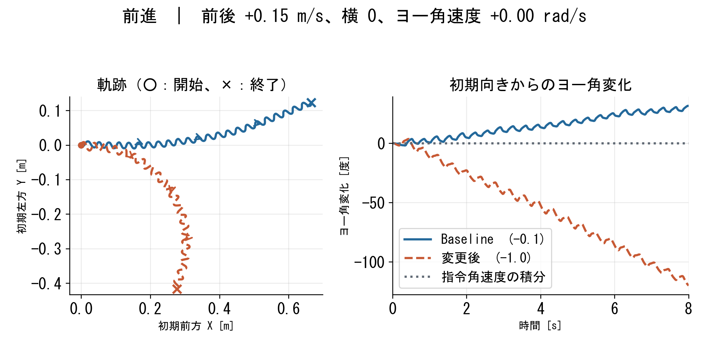

# MicroDuckの速度指令追従と足滑りペナルティの比較

Physical AI 応用編1の最終課題として、MuJoCo上の二足ロボットMicroDuckに速度指令を与え、歩行方策の動きを比較しました。PPO学習時の足滑りペナルティ `foot_slip` の重みが異なる2つの方策を使用しています。

| 方策 | 重み | 対応するcheckpoint | PPO iteration |
|---|---:|---|---:|
| Baseline | -0.1 | `model_1000.pt` | 1001回 |
| 変更後 | -1.0 | `model_999.pt` | 1000回 |

学習コードは番号0から更新後に保存するため、保存番号と更新回数は1ずれます。評価用ONNXの重み・観測正規化値は表中のcheckpointと一致しましたが、書き出し操作の履歴そのものは確認できていません。比較した学習ログの環境設定の差分は `foot_slip` の重みだけですが、最大iterationの設定は異なります。保存時の学習設定は `training_config/` に収録しています。

学習タスクは `Mjlab-Velocity-Flat-MicroDuck` です。このブランチの `src/mjlab_microduck/tasks/microduck_velocity_env_cfg.py` の重みは変更後の-1.0です。Baselineと同じ報酬重みで学習する場合は、別の作業場所で当該設定を-0.1に変更してください。学習用設定は記録として同梱していますが、それだけで学習時の実行環境や結果の完全再現を保証するものではありません。

## 評価条件

各指令を、各方策について同じ初期状態から独立に8秒ずつ実行しました。各条件1回の評価です。初期位置は `(0, 0, 0.125)` m、初期姿勢・関節姿勢・速度・方策の状態も揃えています。指令は機体座標で、ヨー角速度は左回りを正とします。

| 指令 | 前後 [m/s] | 横 [m/s] | ヨー角速度 [rad/s] |
|---|---:|---:|---:|
| 前進 | +0.15 | 0 | 0 |
| 右旋回 | +0.12 | 0 | -1.0 |
| 左旋回 | +0.12 | 0 | +1.0 |
| 後退 | -0.15 | 0 | 0 |

旋回は前進を伴います。物理刻み0.005秒、方策50 Hz、映像10 fpsです。カメラは同じ設定で追尾し、評価時に外乱や初期状態のランダム化は追加していません。動画とCSVは同じ試行から保存しました。転倒目安は胴体の鉛直方向成分0.5未満、または高さ0.07 m未満という簡易判定です。判定後も記録を継続するので、転倒後の動作を成功とは見なしません。

## 結果

同じ指令でも軌跡と向きに違いが現れました。前進の8秒後のヨー角はBaselineが約+31°、変更後が約-120°でした。右旋回の8秒後はそれぞれ約-324°、-390°、左旋回では約+386°、+212°でした。旋回指令±1.0 rad/sを8秒間積分した基準は約±458°ですが、終端角だけでは区間全体の追従性能は判断できません。後退では両方とも初期前方の負方向に移動しましたが、向きも変化しました。

各方策の学習は確認できた範囲で1回、各指令の評価も1回です。接地中の足先の滑り量はこの8秒評価では直接測っていないため、重み変更だけの因果効果や一般的な優劣は断定できません。`results/` に各試行のCSVとグラフを収録しています。軌跡図の表示範囲は指令ごとに異なります。



旋回・後退の図は [右旋回](results/report_figures/figure_right.png)、[左旋回](results/report_figures/figure_left.png)、[後退](results/report_figures/figure_backward.png) を参照してください。

## ディレクトリ

- `models/`：評価に使用した2つのONNX方策。チェックポイントの配布は含みません。
- `training_config/`：両学習の環境・エージェント設定。Baselineの設定は保存時点のログです。
- `evaluate_reset_hd.py`：8秒の独立試行を撮影し、CSVを同時記録します。
- `plot_reset.py`：各指令の軌跡とヨー角を描画します。
- `plot_report.py`：レポート用の日本語グラフを描画します。
- `concat_reset.sh` / `add_reset_caption.sh`：各試行を交互に連結し、日本語のリセット説明を加えます。
- `results/`：各試行のCSV、簡易転倒判定の記録、グラフ。`report_figures/` はレポートに使用した図です。

## 実行方法（Ubuntu / WSL）

Python 3.12、`uv`、EGLでのMuJoCo描画、`ffmpeg`、日本語フォントを用意し、リポジトリ直下で次を実行します。学習には別途CUDA環境が必要ですが、ここでは学習済みONNXを評価します。描画環境によっては実行時間がかかります。

```bash
uv sync --extra submission
mkdir -p output_eval
MUJOCO_GL=egl OPENBLAS_NUM_THREADS=1 OMP_NUM_THREADS=1 uv run python submission/evaluate_reset_hd.py output_eval Baseline
MUJOCO_GL=egl OPENBLAS_NUM_THREADS=1 OMP_NUM_THREADS=1 uv run python submission/evaluate_reset_hd.py output_eval Footslip_m1
MPLBACKEND=Agg uv run python submission/plot_reset.py output_eval
bash submission/concat_reset.sh output_eval
bash submission/add_reset_caption.sh output_eval
```

レポート用の日本語グラフは次のコマンドで再生成できます。WSLの既定ではWindowsのMSゴシックを使用します。別の場所の日本語フォントを使う場合は `MICRODUCK_JAPANESE_FONT` にそのパスを設定します。動画字幕のフォントを変える場合は `MICRODUCK_VIDEO_FONT` に指定してください。

```bash
MPLBACKEND=Agg uv run python submission/plot_report.py output_eval output_eval/report_figures
```

字幕付き動画は `output_eval/comparison_reset_labeled_jp.mp4`、各方策・各指令のCSVは `output_eval/` に出力されます。元のCSVから図だけを再作成する場合は `output_eval` の代わりに `submission/results` を指定できます。数値は環境やライブラリの違いにより完全には一致しない場合があります。

## 既存実装と追加した内容

既存のMicroDuck / mjlab歩行環境、足滑りコスト、PPO学習、ONNX推論を利用しました。今回、`foot_slip` の重み変更と比較用方策の学習、初期状態を揃えた評価、映像・CSVの同時記録、グラフ・比較動画を追加しています。評価・可視化と資料作成にはCodexの支援を利用しました。

元のプロジェクトのコードにはApache 2.0、3DモデルにはCreative Commons BY-SA-NCのライセンスが適用されます。詳細はルートの [LICENSE](../LICENSE) と [README](../README.md) を参照してください。
